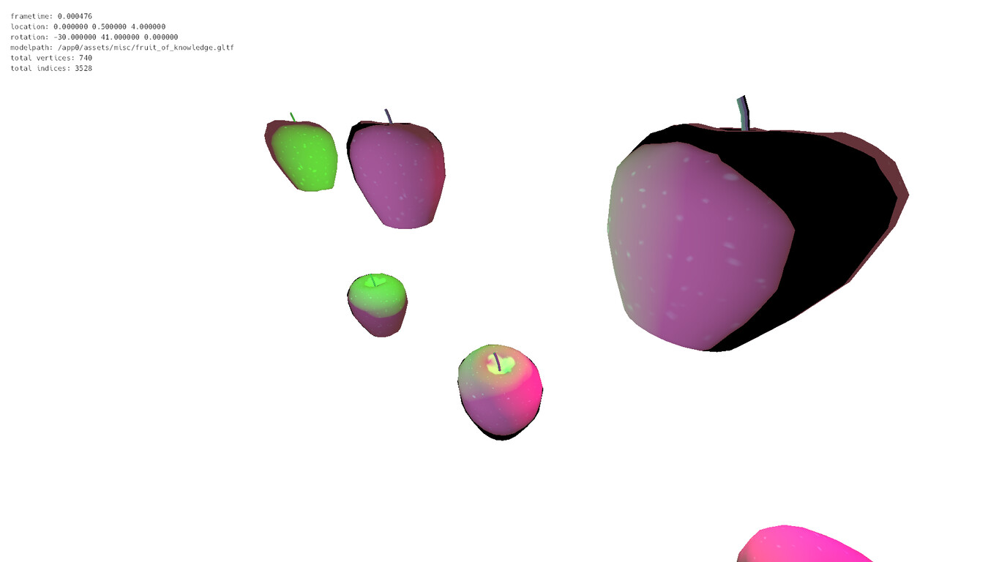

# Example freegnm programs

This repository holds programs to show how to use [freegnm](https://gitgud.io/veiledmerc/freegnm): a GPU library for the PlayStation 4, and [psbc](https://gitgud.io/veiledmerc/psbc): a shader binary compiler also for the PlayStation 4.

These samples are meant to be as simple and straightforward as possible.

**NOTES:**

- There's a bug/glitch where the framebuffer doesn't display some of the pixels at the top correctly. It might be memory related.
- None of these examples were tested on a Pro/NEO PS4 and may not work there.

## Examples available

### Triangle

Very basic example of the GPU's capabilities.


### Primitives

Shows the unique primitive types available in the PS4 hardware.


### Cube

Draws a 3D textured cube.


### GLTF

Renders a GLTF's model with some basic PBR parameters.


### Instances

Example of instanced draw calls usage.



### Indirect

Shows how to setup and use indirect draws.


## Building

You need the following tools to build the projects:

- Clang
- glslc from shaderc
- GNU Make
- LLD linker
- [OpenOrbis Toolchain](https://github.com/OpenOrbis/OpenOrbis-PS4-Toolchain)
- [psbc](https://gitgud.io/veiledmerc/psbc)

Then go to one of the example's directory, and run

```bash
export OO_PS4_TOOLCHAIN=/path/to/OpenOrbis-PS4-Toolchain
make
```

## References

Some of the samples are based on [Vulkan samples from Sascha Willems](https://github.com/SaschaWillems/Vulkan).

Some PBR algorithms are taken from [Moving Frostbite to Physically Based Rendering](https://seblagarde.files.wordpress.com/2015/07/course_notes_moving_frostbite_to_pbr_v32.pdf).

## Libraries and resources

The following libraries are used:

- [cglm](https://github.com/recp/cglm), MIT license
- [cgltf](https://github.com/jkuhlmann/cgltf), MIT license
- [Nuklear](https://immediate-mode-ui.github.io/Nuklear), Public Domain or MIT license
- [stb_image and stb_truetype](https://github.com/nothings/stb), Public Domain or MIT license

The following resources are used:

- [Stanford dragon](https://graphics.stanford.edu/data/3Dscanrep) by Stanford Computer Graphics Laboratory, non-commercial use only
- [Hack typeface](https://sourcefoundry.org/hack) by SourceFoundry, MIT license
- Screenshots of Dark Knight Rises film's plane scene

The libraries and resources are owned by their respective owners and are not covered by this project's license.

## License

This project is released under Public Domain, see [UNLICENSE](UNLICENSE) for more information.
